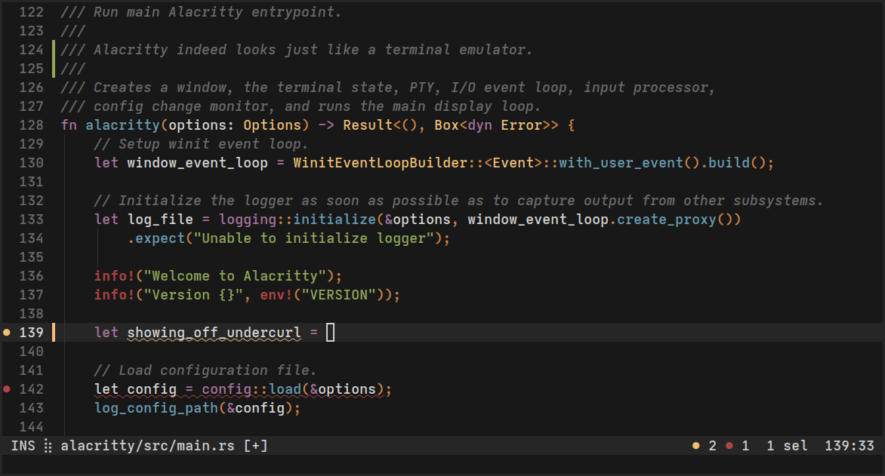

<p align="center">
    
</p>

<h1 align="center">Alacritty (lassejlv fork)</h1>

<p align="center">
  A personal fork of <a href="https://github.com/alacritty/alacritty">Alacritty</a>,
  the fast, cross-platform, OpenGL terminal emulator, with tabs, split panes,
  color themes and modern terminal protocols.
</p>

<p align="center">
  <a href="https://github.com/lassejlv/alacritty/releases/latest">Download</a> ·
  <a href="#whats-different">What's different</a> ·
  <a href="#installation">Installation</a> ·
  <a href="#configuration">Configuration</a> ·
  <a href="CHANGELOG.md">Changelog</a>
</p>

<p align="center">
  
</p>

> [!NOTE]
> This is an unofficial fork and is not affiliated with or endorsed by the
> Alacritty project. Please report issues with this fork
> [here](https://github.com/lassejlv/alacritty/issues), not upstream.

## About

Alacritty is a modern terminal emulator with sensible defaults, extensive
configuration and high performance. This fork keeps the upstream core and adds
features that upstream deliberately leaves out, such as tabs, splits and native
desktop integration, along with support for newer terminal protocols.

It builds for BSD, Linux, macOS and Windows. Most of the native integration
targets macOS first.

## What's different

### Tabs, panes and windows

- Native macOS tabs (<kbd>Cmd</kbd> <kbd>T</kbd>) and separate windows (<kbd>Cmd</kbd> <kbd>N</kbd>).
- Nested split panes within each tab (<kbd>Cmd</kbd> <kbd>D</kbd> / <kbd>Cmd</kbd> <kbd>Shift</kbd> <kbd>D</kbd>), with draggable dividers and dimmed inactive panes.
- Maximize and restore the focused pane (<kbd>Cmd</kbd>/<kbd>Ctrl</kbd> <kbd>Shift</kbd> <kbd>Enter</kbd>).
- Independent font zoom per pane.

### Themes

- 66 built-in color themes converted from popular Ghostty themes, selected with `general.theme`.
- User themes in `~/.config/alacritty/themes/`.
- `alacritty themes` lists every available theme.

### Terminal protocols

- [Kitty graphics](docs/protocols/kitty-graphics.md) and [Kitty clipboard](docs/protocols/kitty-clipboard.md).
- [Shell integration](docs/protocols/shell-integration.md): OSC 133 command tracking and navigation, copying command output, OSC 7 working directory and automatic zsh integration.
- [Desktop notifications](docs/protocols/notifications.md) through OSC 99 and iTerm2-style OSC 9.
- [Progress indicators](docs/protocols/progress.md) through OSC 9;4, shown per pane and on the macOS Dock, Windows taskbar and Linux launchers.
- [Program status](docs/protocols/program-status.md) through OSC 7501, shown in window and tab titles.

### macOS integration

- Native menus and a terminal context menu.
- Signed, notarized universal builds with automatic updates through Sparkle.
- Migration of an existing Ghostty config with **Alacritty → Migrate Ghostty Config…**.
- <kbd>Cmd</kbd> <kbd>A</kbd> selects the whole buffer and <kbd>Cmd</kbd> <kbd>Delete</kbd> clears the current input line.

See [macOS features](docs/features/macos.md) for the full list of shortcuts.

### Embedding

The [`alacritty_ffi`](crates/ffi/README.md) crate exposes the terminal engine
through a C ABI, a pkg-config package and Python bindings, so you can build your
own terminal on top of Alacritty. Run `make ffi` to package it.

All upstream features, including vi mode, search, hints and IPC, are still
available. They are described in [features](docs/features/README.md).

## Installation

### macOS

Download `Alacritty-macos-universal.dmg` from the
[latest release](https://github.com/lassejlv/alacritty/releases/latest). The
app is a universal Apple Silicon/Intel build and updates itself through
**Alacritty → Check for Updates…**.

### From source

The workspace requires Rust 1.99 or newer:

```sh
git clone https://github.com/lassejlv/alacritty.git
cd alacritty
cargo build --release --locked
```

On macOS, `make app` builds `Alacritty.app` under `target/release/osx/`.

Platform dependencies, terminfo, desktop entries, manpages and shell
completions are covered in the [installation guide](docs/installation.md).

### Requirements

- OpenGL ES 2.0 or newer.
- On Windows, ConPTY support (Windows 10 version 1809 or newer).

## Configuration

Alacritty doesn't create a config file for you. It looks for one in these
locations:

1. `$XDG_CONFIG_HOME/alacritty/alacritty.toml`
2. `$XDG_CONFIG_HOME/alacritty.toml`
3. `$HOME/.config/alacritty/alacritty.toml`
4. `$HOME/.alacritty.toml`
5. `/etc/alacritty/alacritty.toml`

On Windows, it looks in `%APPDATA%\alacritty\alacritty.toml`.

A minimal config that picks a theme:

```toml
[general]
theme = "apple-system-colors"
```

All options are documented in `man 5 alacritty`
([source](docs/man/alacritty.5.scd)). The
[upstream website](https://alacritty.org/config-alacritty.html) covers the
shared options, but it doesn't include this fork's additions.

## Development

- [Workspace architecture](docs/architecture.md) explains the crate layout.
- The [development guide](docs/development.md) covers local checks.
- [Releases](docs/releases.md) describes the signed macOS release pipeline.

```sh
cargo test --locked --workspace
cargo clippy --workspace --all-targets
```

## FAQ

**_Why a fork?_**

Upstream Alacritty intentionally leaves out tabs, splits and similar
features, and recommends a window manager or a multiplexer such as
[tmux](https://github.com/tmux/tmux) instead. This fork adds them for people who
want them built in, without changing the fast core.

**_Is it really the fastest terminal emulator?_**

Benchmarking terminal emulators is complicated. Upstream Alacritty uses
[vtebench](https://github.com/alacritty/vtebench) to measure throughput and
consistently scores well. Latency, framerate and frame consistency are harder
to quantify. The best test is always your own workload.

## Credits and license

All credit for Alacritty goes to its
[authors and contributors](https://github.com/alacritty/alacritty/graphs/contributors).
This fork is released under the same terms as upstream: the
[Apache License, Version 2.0](LICENSE-APACHE). The config crates and the
vendored `vte` parser are dual-licensed under the [MIT License](LICENSE-MIT).
